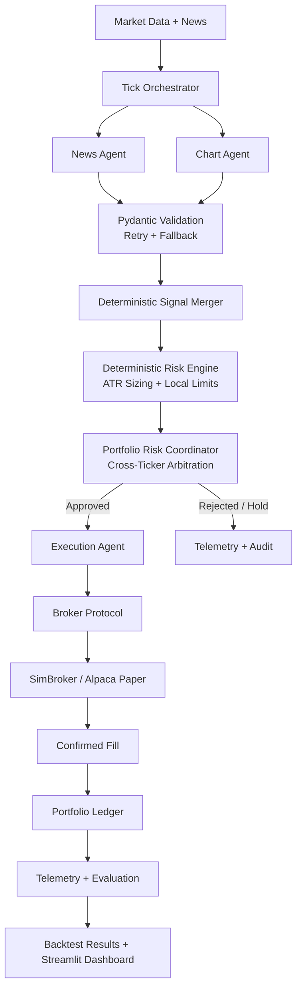

<div align="center">

# 📈 AI Multi-Agent Trading Firm

### Auditable Multi-Agent Trading Research & Backtesting Platform

**LLM agents interpret market evidence. Deterministic risk, portfolio, execution, and accounting systems authorize every action.**

[](https://www.python.org/)
[](https://github.com/langchain-ai/langgraph)
[](#testing)
[](https://streamlit.io/)
[](LICENSE)

> ⚠️ **For historical backtesting and paper trading only. No real capital is at risk.**

🔗 **Live Demo:** [Streamlit App](https://ai-multi-agent-trading-firm-ft7czhcn94s7flzhj96pk3.streamlit.app/)

</div>

---

## Overview

**AI Multi-Agent Trading Firm** is a reproducible trading research platform that combines LLM-driven market interpretation with deterministic financial controls.

News and technical-analysis agents generate structured market signals, but they cannot directly place trades, alter risk limits, or modify portfolio accounting. A deterministic control plane validates signals, authorizes risk, arbitrates portfolio constraints, executes approved orders, and maintains the ledger.

> **LLMs propose. Deterministic systems decide.**

---

## Architecture



---

## Key Features

### Multi-Agent Orchestration

- LangGraph pipeline with parallel News and Chart agents
- Multi-ticker fan-out using isolated ticker-level subgraphs
- Deterministic signal merger reconciles agent outputs
- Explicit `HOLD` and `REJECT` paths prevent unauthorized trades

### Deterministic Risk Controls

A bullish LLM signal does **not** automatically become an order.

| Control | Default |
|---|---:|
| Risk per trade | 1% of equity |
| Stop methodology | 1.5× ATR |
| Maximum position per ticker | 20% |
| Maximum sector exposure | 40% |
| Maximum concurrent positions | 3 |
| Daily circuit breaker | -3% |
| Correlation threshold | 0.7 |

The risk engine can approve, reject, or downsize proposals and halts trading once the daily loss limit is breached.

### Safe LLM Integration

- LLM responses are treated as untrusted structured inputs
- Pydantic validates every agent output
- Invalid outputs trigger retry and safe fallback
- Malformed output cannot reach risk or execution layers

### Broker-Agnostic Execution

- Common broker protocol supports SimBroker and Alpaca Paper
- Idempotent order handling prevents duplicate accounting
- Portfolio state updates only after confirmed fills
- Ledger supports weighted-average cost, partial sells, realized P&L, cash, and open positions

### Lookahead-Safe Backtesting

- Historical sessions replay through the same production pipeline
- Each run uses fresh portfolio state and a simulated date
- Data access is restricted to information available at the current tick
- Results are benchmarked against equal-weight buy-and-hold

---

## Observability

Every tick can be reconstructed across the decision path:

```text
Market Data → Agent Signal → Signal Merge → Risk Decision →
Portfolio Arbitration → Execution → Fill → Ledger → Performance
```

Structured telemetry records agent signals, confidence, proposed quantity, risk decisions, portfolio decisions, execution outcomes, fills, news provenance, and portfolio state.

---

## Tech Stack

| Layer | Tools |
|---|---|
| Agent orchestration | LangGraph |
| LLM inference | Groq / GPT-OSS |
| Structured validation | Pydantic |
| Guardrails | NeMo Guardrails |
| Market data | Alpaca, yfinance |
| News | NewsAPI |
| Broker execution | SimBroker, Alpaca Paper |
| Portfolio accounting | JSON-backed ledger |
| Observability | LangSmith, structured telemetry |
| Dashboard | Streamlit |
| Testing | pytest, GitHub Actions |

---

## Quick Start

### Prerequisites

- Python 3.13+
- pip

### Installation

```bash
git clone [https://github.com/your-username/ai-multi-agent-trading-firm.git](https://github.com/your-username/ai-multi-agent-trading-firm.git)
cd ai-multi-agent-trading-firm
pip install -r requirements.txt
```

### Configure environment

Create a `.env` file:

```env
GROQ_API_KEY=your_groq_api_key
NEWSAPI_KEY=your_newsapi_key

ALPACA_API_KEY=your_alpaca_api_key
ALPACA_API_SECRET=your_alpaca_api_secret

TRADING_MODE=backtest

LANGCHAIN_TRACING_V2=true
LANGCHAIN_API_KEY=your_langsmith_api_key
LANGCHAIN_PROJECT=ai-multi-agent-trading-firm
```

### Run a backtest

```bash
python -m backtest.runner \
  --tickers AAPL,MSFT,GOOGL,JPM \
  --start 2026-08-25 \
  --end 2026-09-20 \
  --run-id sep2026
```

### Launch dashboard

```bash
streamlit run ui.py
```

### Run tests

```bash
pytest tests/ -v
```

---

## Testing

The project includes **168 automated tests** covering portfolio accounting, risk controls, guardrails, backtesting, orchestration, broker execution, and failure scenarios.

CI runs the test suite through GitHub Actions.

---

## License

Distributed under the MIT License. See [`LICENSE`](LICENSE) for more information.
